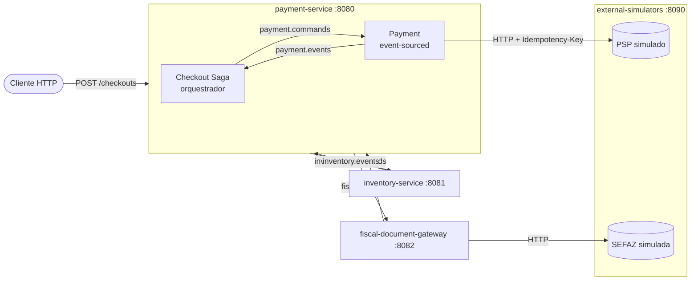

# Rollback não existe em Event Sourcing — projeto de exemplo

Código que acompanha o artigo **"Rollback não existe em Event Sourcing: Saga, compensação e Kafka num fluxo de pagamento com NF-e"**.

É um checkout de e-commerce em microsserviços Java 21 / Spring Boot 3, com Kafka (retry topics + DLQ), PostgreSQL, Clean Architecture + DDD, e os 7 casos de falha do artigo reproduzíveis com um `curl`.


## Ecossistema



| Serviço | Responsabilidade | Banco |
|---|---|---|
| **payment-service** | Domínio de **Pagamento** (`Payment`, event-sourced) e a **Checkout Saga**, que orquestra o fluxo e **solicita a emissão da NF-e** | `payment` |
| **fiscal-document-gateway** | O **único** serviço que fala com a SEFAZ: emite, consulta e cancela NF-e (evento 110111) | `fiscal` |
| **inventory-service** | Reserva e libera estoque | `inventory` |
| **external-simulators** | SEFAZ e gateway de pagamento (PSP) com cenários de falha | — |

Cada serviço tem o seu banco. Nenhum compartilha código com outro: só os **contratos das mensagens** os ligam.

### C4 model

Fontes PlantUML ([C4-PlantUML](https://github.com/plantuml-stdlib/C4-PlantUML)) em [docs/c4](docs/c4), com o SVG gerado ao lado:

| Nível | Diagrama |
|---|---|
| L2 — Containers | [L2-containers.puml](docs/c4/L2-containers.puml) · [SVG](docs/c4/L2-containers.svg) |
| L3 — payment-service | [L3-payment-service.puml](docs/c4/L3-payment-service.puml) · [SVG](docs/c4/L3-payment-service.svg) |
| L3 — fiscal-document-gateway | [L3-fiscal-document-gateway.puml](docs/c4/L3-fiscal-document-gateway.puml) · [SVG](docs/c4/L3-fiscal-document-gateway.svg) |
| L3 — inventory-service | [L3-inventory-service.puml](docs/c4/L3-inventory-service.puml) · [SVG](docs/c4/L3-inventory-service.svg) |
| L3 — external-simulators | [L3-external-simulators.puml](docs/c4/L3-external-simulators.puml) · [SVG](docs/c4/L3-external-simulators.svg) |


## A saga

| Passo | Ação | Compensação |
|---|---|---|
| T1 | Pedido criado | Pedido cancelado (`OrderCancelled`) |
| T2 | Pagamento pré-autorizado (`PaymentAuthorized`) | Autorização cancelada — void (`AuthorizationVoided`) |
| T3 | Estoque reservado (`InventoryReserved`) | Reserva liberada (`ReservationReleased`) |
| T4 | NF-e autorizada na SEFAZ (`InvoiceAuthorized`) | NF-e cancelada — evento 110111 (`InvoiceCancelled`) |
| T5 | **Pagamento capturado — pivô** (`PaymentCaptured`) | Estorno — refund (`PaymentRefunded`) |

A captura é o **último** passo de propósito: os passos estão ordenados pelo custo de desfazer. A máquina de estados está em [CheckoutSaga.java](payment-service/src/main/java/br/com/example/payment/domain/checkout/CheckoutSaga.java), em Java puro, sem I/O.

## Clean Architecture + DDD

Todos os serviços seguem a mesma estrutura:

```
domain/          Agregados, value objects e eventos. Java puro: sem Spring, Kafka ou SQL.
application/
  port/in/       Casos de uso (o que o serviço oferece)
  port/out/      O que o serviço precisa (event store, PSP, SEFAZ, outbox, inbox, transação)
  service/       Implementação dos casos de uso
infrastructure/  Adapters: Kafka listeners, JDBC, clientes HTTP, controllers e o composition root
```

- A camada de aplicação não tem nenhuma anotação do Spring. As transações são explícitas via a porta `UnitOfWork`, e isso importa: toda chamada externa acontece **fora** da transação, entre um "registrar intenção" e um "registrar resultado".
- No payment-service há dois **bounded contexts**: `checkout` (a saga) e `payment` (o agregado). A saga não conhece o agregado: ela envia comandos e ouve eventos pelo Kafka, como faz com os outros serviços.

## Onde está cada conceito do artigo

| Artigo | Onde ver no código |
|---|---|
| **§1 Desfazer é registrar um novo fato** | [Payment.java](payment-service/src/main/java/br/com/example/payment/domain/payment/Payment.java) (`rehydrate`, `apply`) e [PaymentEvent.java](payment-service/src/main/java/br/com/example/payment/domain/payment/PaymentEvent.java). `GET /payments/{id}` mostra o stream v1..vN |
| **NF-e também é event sourcing** | [Invoice.java](fiscal-document-gateway/src/main/java/br/com/example/fiscal/domain/Invoice.java): cancelar adiciona um `SefazEvent` 110111, nada é apagado |
| **Caso 1** SEFAZ rejeita | NCM `00000000` → `InvoiceRejected` → `ReservationReleased` → `AuthorizationVoided` → `OrderCancelled` |
| **Caso 2** captura falha após NF-e | Retry com backoff ([PaymentCommandsListener](payment-service/src/main/java/br/com/example/payment/infrastructure/messaging/PaymentCommandsListener.java)) + Idempotency-Key; recusa definitiva cancela a NF-e; **prazo da saga** (`checkout.capture-deadline`) em [SagaDeadlineScheduler](payment-service/src/main/java/br/com/example/payment/infrastructure/scheduling/SagaDeadlineScheduler.java); fora do prazo legal → `MANUAL_INTERVENTION` |
| **Caso 3** timeout na SEFAZ | [InvoiceService.issue](fiscal-document-gateway/src/main/java/br/com/example/fiscal/application/service/InvoiceService.java): a chave de acesso (`AccessKey`) é gravada antes do envio; no timeout a nota vai para `STATUS_UNKNOWN` e o retry **consulta pela chave** antes de reenviar. Contingência (`PENDING_CONTINGENCY`) quando a SEFAZ some de vez |
| **Caso 4** evento duplicado | Inbox `processed_messages` em todo consumidor + Idempotency-Key no PSP. O inventory-service publica tudo **duas vezes** de propósito (`OUTBOX_SIMULATE_DUPLICATE_DELIVERY`) |
| **Caso 5** dual write | Transactional Outbox: [JdbcPaymentEventStore.save](payment-service/src/main/java/br/com/example/payment/infrastructure/persistence/JdbcPaymentEventStore.java) grava o evento e o outbox na mesma transação; o [OutboxRelay](payment-service/src/main/java/br/com/example/payment/infrastructure/messaging/OutboxRelay.java) publica. Alternativa com Debezium em [docs/debezium-outbox.json](docs/debezium-outbox.json) |
| **Caso 6** compensação falhou | Compensação idempotente → retry topics → DLQ → tabela `pending_reconciliation` + alerta → `GET /reconciliations` e `POST /reconciliations/{id}/reprocess` |
| **Caso 7** fora de ordem | Chave de partição = `orderId` em todos os tópicos; PK `(payment_id, version)` no event store (concorrência otimista); a máquina de estados ignora eventos fora de hora |
| **Timeout não é falha** (também no PSP) | Compensar um pagamento com `CAPTURE_REQUESTED` sem resposta → `CompensationAction.QUERY_PSP` antes de decidir entre void e refund |
| **Orquestração** | Estado, timers, retries e compensações num lugar só; `GET /checkouts/{orderId}` responde "em que passo está o pedido?" |

## Glossário (artigo → código)

| Artigo (PT) | Código (EN) |
|---|---|
| Pagamento, Pedido, Cliente | `Payment`, `Order`, `Customer` |
| Pré-autorização / captura / estorno / cancelamento da autorização | `authorize` / `capture` / `refund` / `voidAuthorization` |
| Estoque, Reserva | `Inventory`, `Reservation`, `StockItem` |
| Nota fiscal (NF-e), chave de acesso, emitente, destinatário | `Invoice`, `AccessKey`, `Issuer`, `Recipient` |
| Evento da NF-e (110111 cancelamento) | `SefazEvent.CANCELLATION` |
| Conciliação | `Reconciliation` (`ReconciliationLog`, `PendingItem`) |
| Caixa de entrada (inbox), unidade de trabalho | `Inbox`, `UnitOfWork` |
| Prazo de captura / prazo de cancelamento | `captureDeadline` / `cancellationDeadline` |
| Situação desconhecida, contingência, intervenção manual | `STATUS_UNKNOWN`, `PENDING_CONTINGENCY`, `MANUAL_INTERVENTION` |

## Retry e DLQ no Kafka

| Tópico | Produtor → consumidor |
|---|---|
| `payment.commands` / `payment.events` | saga ↔ agregado Payment |
| `inventory.commands` / `inventory.events` | saga ↔ inventory-service |
| `fiscal.commands` / `fiscal.events` | saga ↔ fiscal-document-gateway |
| `checkout.events` | saga → quem quiser ouvir (`OrderConfirmed`, `OrderCancelled`) |

Cada consumidor usa `@RetryableTopic` com backoff exponencial:

```
payment.commands → payment.commands-retry-0 (2s) → -retry-1 (4s) → -retry-2 (8s) → payment.commands-dlq
```

- `TransientFailureException` (5xx, timeout, conflito de versão) → retry.
- `InvalidMessageException` (poison pill) → direto para a DLQ.
- O `@DltHandler` de cada serviço registra o alerta e decide o próximo passo: conciliação no pagamento, contingência na emissão da NF-e, aviso à saga no cancelamento.

Veja os tópicos no Kafka UI: http://localhost:8085

## Como rodar

Pré-requisitos: Docker. Para rodar os testes sem Docker: JDK 21 e Maven.

```bash
docker compose up --build
```

Depois, dispare os cenários de [scripts/scenarios.http](scripts/scenarios.http) (REST Client do VS Code ou HTTP Client do IntelliJ), ou com curl:

```bash
curl -X POST localhost:8080/checkouts -H 'Content-Type: application/json' -d '{"orderId":"case1-001","customer":{"name":"Maria Silva","document":"12345678909"},"items":[{"sku":"SKU-TSHIRT","description":"T-shirt","ncm":"00000000","quantity":1,"unitPrice":59.90}],"cardToken":"tok_ok"}'
```

```bash
curl localhost:8080/checkouts/case1-001
```

### Dados que disparam cada cenário

| Campo | Valor | Efeito |
|---|---|---|
| `ncm` | `00000000` | SEFAZ rejeita (778) — **Caso 1** |
| `ncm` | `11111111` | SEFAZ autoriza, mas responde depois do timeout — **Caso 3** |
| `ncm` | `22222222` | SEFAZ fora do ar → DLQ → contingência |
| `cardToken` | `tok_auth_declined` | Pré-autorização recusada |
| `cardToken` | `tok_capture_flaky` | Captura falha 2x e passa no retry — **Caso 2** |
| `cardToken` | `tok_capture_declined` | Captura recusada definitivamente → cancela NF-e — **Caso 2** |
| `cardToken` | `tok_capture_down` | Captura nunca responde → DLQ → **prazo da saga** cancela a NF-e — **Caso 2** |
| `cardToken` | `tok_void_down` | Void fora do ar → DLQ → conciliação — **Caso 6** (combine com NCM `00000000`) |
| `sku` | `SKU-SOLD-OUT` | Estoque indisponível |

Para ver o **cancelamento extemporâneo**, suba o simulador com `SIMULATOR_SEFAZ_CANCELLATION_DEADLINE=PT30S` e use `tok_capture_down`: quando a saga tentar cancelar a NF-e, o prazo já passou e ela vai para `MANUAL_INTERVENTION`.

### Testes

```bash
mvn verify
```

Os testes de domínio e de casos de uso rodam sem Spring, Kafka ou banco: a saga, o agregado `Payment` e o Caso 3 inteiro (timeout → consulta → sem reemissão) são testados com adapters em memória.

## Simplificações (de propósito)

- A SEFAZ real é SOAP com XML assinado, lote, recibo e contingência EPEC/SVC. Aqui é JSON, para focar no fluxo. Os campos do leiaute oficial (`cStat`, `xMotivo`, `nProt`, `tpEvento`, `xJust`) mantêm o nome original.
- O outbox é publicado por polling. Em produção, prefira CDC (Debezium) — config de exemplo em `docs/`.
- Sem Schema Registry: os contratos são JSON num envelope `{id, type, orderId, occurredAt, payload}`. O artigo recomenda Schema Registry com regras de compatibilidade no CI.
- Sem snapshots no event store e sem estratégia de LGPD (crypto-shredding). Ambos estão listados como custos no artigo.
- O scheduler de prazos roda em cada instância. Em cluster, use ShedLock ou Quartz.
- O código de infraestrutura (outbox, inbox, envelope) está duplicado entre os serviços de propósito, para que cada um continue independente.
